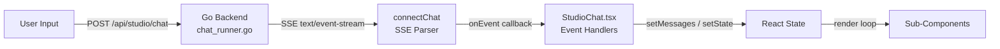
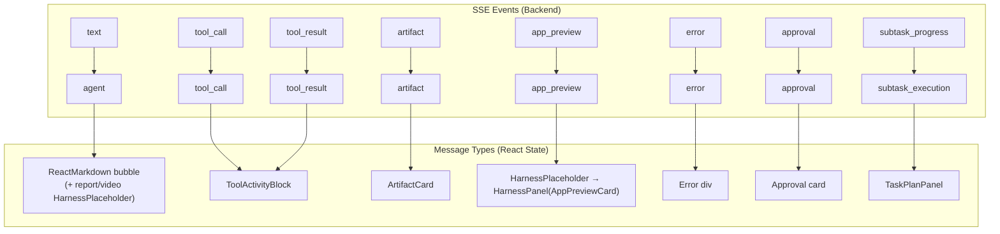
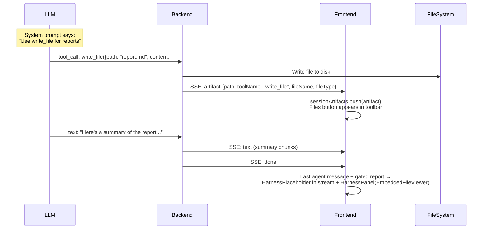
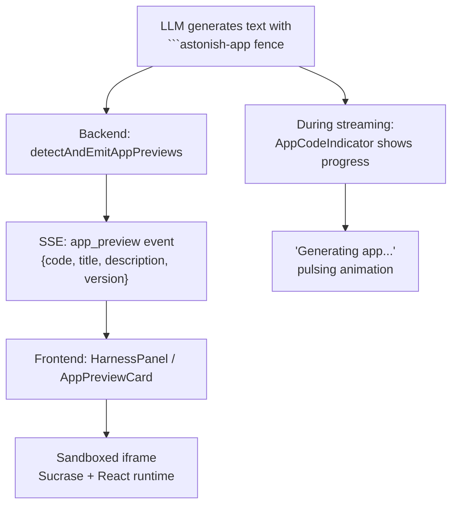
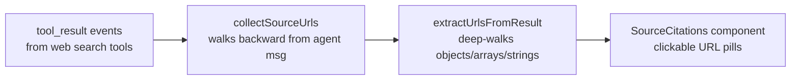
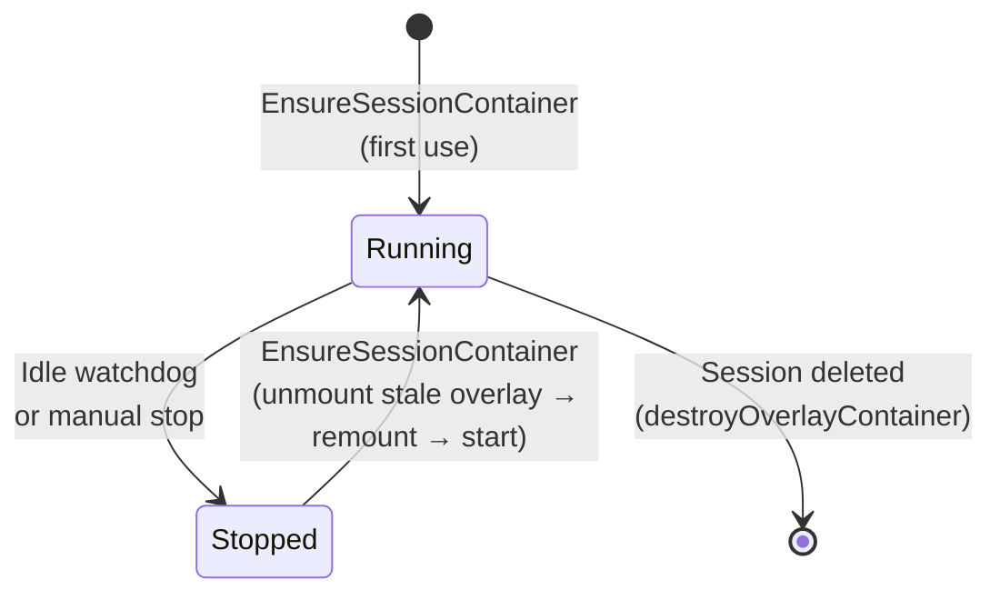

# Chat Rendering Pipeline

## Overview

The Studio Chat (`StudioChat.tsx`) is the primary user interface for Astonish. It orchestrates 17 sub-components, manages 35 state variables, handles 29 SSE event types from the backend, and renders 21 distinct message types. This document is the authoritative reference for how the pipeline works, how to extend it, and what rules must be followed.

**Target audience:** Developers adding new SSE event types, new rendering components, or modifying the report/app/artifact pipelines.

## End-to-End Data Flow

The rendering pipeline is a unidirectional flow from user input to rendered UI:



### Detailed pipeline:

```mermaid
sequenceDiagram
    participant User
    participant StudioChat
    participant connectChat
    participant Backend
    participant LLM

    User->>StudioChat: Types message, clicks Send
    StudioChat->>connectChat: POST /api/studio/chat {message, sessionId}
    connectChat->>Backend: HTTP POST (streaming response)
    Backend->>LLM: Forward prompt
    LLM-->>Backend: Stream tokens
    Backend-->>connectChat: SSE: event:text, data:{text:"Hello"}
    connectChat-->>StudioChat: onEvent("text", {text:"Hello"})
    StudioChat->>StudioChat: setMessages() — append/update agent message
    StudioChat->>StudioChat: React re-render → ReactMarkdown bubble

    Note over Backend,LLM: LLM decides to call a tool
    LLM-->>Backend: tool_call(write_file, {path, content})
    Backend-->>connectChat: SSE: event:tool_call
    Backend->>Backend: Execute tool, write file to disk
    Backend-->>connectChat: SSE: event:tool_result
    Backend-->>connectChat: SSE: event:artifact

    Note over Backend,LLM: LLM writes final summary
    LLM-->>Backend: Stream summary text
    Backend-->>connectChat: SSE: event:text (summary chunks)
    Backend-->>connectChat: SSE: event:done

    StudioChat->>StudioChat: Last agent message has gated report →<br/>HarnessPlaceholder + HarnessPanel + Files button
    StudioChat->>User: Rendered: Agent bubble + placeholder; report in side panel
```

## SSE Transport Layer

SSE parsing is implemented **manually** using the `ReadableStream` API in `web/src/api/studioChat.ts` -- not the browser's native `EventSource`. This is because the initial request is a `POST` (EventSource only supports GET).

Two functions share identical parsing logic:

| Function | HTTP Method | Endpoint | Purpose |
|----------|------------|----------|---------|
| `connectChat()` | POST | `/api/studio/chat` | Send a new message, receive streaming response |
| `connectChatStream()` | GET | `/api/studio/sessions/{id}/stream` | Reconnect to an active background runner |

**Parsing flow:**
1. Read chunks from `response.body.getReader()` via `TextDecoder`
2. Accumulate into a buffer, split on `\n\n` (SSE block delimiter)
3. For each block: extract `event:` type and `data:` payload from lines
4. `JSON.parse(data)` and call `onEvent(eventType, parsedData)`
5. On stream end, call `onDone()`

**Both connect paths must have identical event handlers.** When adding a new event type, the `case` must be added to both the `connectChat` handler (in `sendMessage`) and the `connectChatStream` handler (in the reconnect logic). Missing one causes events to be silently dropped on reconnect. Persisted transcript DTOs must also map the type during history loading; for example, `docs_update` is projected into a typed slide message and rendered by `SlidesCard` in all three paths.

## Streaming progress, completion and delivery boundaries

### Generation progress is not model content

`ChatRunner.Run` (`pkg/api/chat_runner.go`) binds the context-scoped provider progress callback from `pkg/provider/streaming`. It translates `PhaseThinking` into `thinking: {text: "Model is thinking…"}` and `PhaseToolArguments` into `thinking: {text: "Preparing tool arguments…"}`. Structured `Thought` responses have a bounded status fallback. These are static process notes, never raw reasoning, tool names or unfinished argument JSON. Notifications are bounded by phase transitions/once-per-phase guards, not emitted for every token; lack of a notification is not evidence of a stalled provider.

Both Studio send and reconnect handlers update one ephemeral `generationProgress` status; they do not append `thinking` to the transcript or split assistant text. Legacy `thinking` records are omitted by the display projection, without English-text matching or rewriting saved history. Visible text, validated tool activity, actionable boundaries, completion, error, EOF, stop and session/turn changes clear the temporary status. The bottom indicator prioritizes an active tool, then generation progress, then the existing Thinking… fallback. Thus “Preparing tool arguments…” may appear temporarily while waiting, but never accumulates as Notes or assistant bubbles.

The remote terminal path (`pkg/launcher/tui_chat.go`, `mapSSEToEvents`) still consumes the same event and maps it into the terminal event model. Its sticky/linear presentation is unchanged; Studio's chronological nested bubbles are not a terminal redesign. This introduces no new event and does not promise progress support from all providers (notably direct Google GenAI's ADK adapter).

Before visible text or a validated tool arrives, progress may be the only generation signal. Once text arrives it streams normally. A failed stream surfaces an error rather than converting buffered argument fragments into a `tool_call`. A `done` event finalizes the turn, but does **not** certify that generation succeeded: it follows failure paths too. Provider-specific terminal evidence and replay guards are documented in [Provider Integrations](providers.md#streaming-safety-and-generation-progress).

### History is authoritative; subscriber notifications are best effort

Both initial POST and active-run GET reconnect use `streamRunnerEvents` (`pkg/api/chat_handlers.go`):

1. Subscribe **before** reading history, closing the catch-up/live race.
2. Start a connection-local cursor at zero. `ChatRunner.GetHistoryFrom(cursor)` returns the ordered events to write; advance the cursor only after each event has been written and flushed successfully.
3. Drain again after every batch to include events appended during a slow write. The bounded `Subscribe` channel (capacity 200) is only a wakeup signal; notification payloads are not the source for SSE delivery. Overflow may discard wakeups, not the authoritative buffered history.
4. After observing subscriber-channel closure, perform a final history drain and return only after an empty read. A late subscription is immediately closed once subscribers have been closed, but its existing history is still drained.

This provides ordered, lossless catch-up within a retained runner even if completion happens during replay or a reader falls behind the notification buffer. The cursor is internal to this HTTP connection: it is **not** an SSE `id` / `Last-Event-ID` protocol or a durable exactly-once delivery guarantee across disconnects, process restarts or runner eviction. A reconnect starts from the retained runner's history; persisted transcript reconstruction remains a separate path.

### Turn completion and transport closure are distinct

`ChatRunner.Run` appends `done` to history **before** setting the state observed by `IsDone()`. Error/panic completion likewise records its completion event before marking done. The SSE transport does not use `IsDone()` as EOF: best-effort refined `session_title` can follow `done`, while the provisional title was emitted earlier. Subscriber closure waits for title refinement or the existing title-wait bound; the final drain delivers any appended title. Studio can stop its processing indicator on `done` without closing the reader prematurely.

When waiting for activity, the transport writes the existing `: heartbeat\n\n` SSE comment every 15 seconds and flushes it. This is connection maintenance, not generation progress or a model timeout. Event/heartbeat write failures and supported flush errors terminate only that subscriber; HTTP request cancellation also unsubscribes without cancelling the background runner. Explicit runner stop remains the cancellation mechanism. A failed socket cannot guarantee delivery to that reader, but it must not abort the ongoing turn.

Provider iteration and downstream callbacks are synchronous, so slow downstream processing can delay a provider read. The history/wakeup separation prevents notification-buffer pressure from requiring model-output loss; it does not make all callbacks or socket writes nonblocking, establish backpressure as the cause of an upstream HTTP/2 reset, or add a new generation timeout.

### Focused regression checks

```bash
go test ./pkg/api -run 'TestChat(GenerationProgress|StreamDelivery)'
```

Key cases are `TestChatGenerationProgressHTTP`, `TestChatGenerationProgressThoughtIsBoundedAndPrivate`, `TestChatStreamDeliveryOverflow`, `TestChatStreamDeliveryCompletionDuringReplay`, `TestChatStreamDeliveryHistoryCursor`, `TestChatStreamDeliveryLateSubscription`, `TestChatStreamDeliveryTitleAfterDone`, `TestChatStreamDeliveryDisconnect`, `TestChatStreamDeliveryWriteFailure`, and `TestChatStreamDeliveryHeartbeat`. These commands name regression coverage, not a recorded live-provider pass count.

### Chronological activity acceptance

The focused phase runs the eight projection/component/scenario suites named in the execution plan, builds the SPA, then runs `TestChatChronologyHTTPAcceptance*` with browser opt-in. The isolated harness serves the built SPA on loopback with temporary SQLite databases and browser profiles; it does not use the user's daemon or existing chats. Explicit opt-in fails on missing SPA/browser prerequisites rather than skipping.

Browser coverage includes ordinary text and counted tool execution, gated A/tool/B/tool/C with real emphasis/lists/code and >280-character intermediate text, keyboard disclosure in light/dark, transient status removal, active reconnect, and SQLite/agent reopen. Three edge subtests cover tool-only, parallel same-name tools and failures live/restored. One additional scripted HTTP/SSE presentation case verifies an actionable approval remains between two folds (it does not approve a real operation). `TestMemoryHTTPAcceptance_Browser` independently retains its 12 memory/debug checks. Provider recovery is covered by the SAP race suite, not a live SAP request.

Recorded local acceptance (2026-10-19): the full command exited 0; **107 frontend files / 789 tests passed**, TypeScript and production bundles built, API/TUI/launcher and SAP race suites passed. Chrome ran the baseline and gated chronology targets, all **3** edge cases, **1** scripted actionable-boundary case and **12/12** memory/debug cases. The browser caught a wrapped-result classification failure, now covered by a failing-before/passing-after unit test. Tool-failure browser coverage uses an `Error:`-prefixed failure because the backend can also emit plain untyped error text; arbitrary unmarked strings cannot reliably be classified by this presentation-only change. No live SAP call, deployed platform validation, daemon restart or existing-session mutation was performed.

Full compatibility command, run from the repository root:

```bash
go test ./pkg/api/... ./pkg/tui/... ./pkg/launcher/... &&
go test -race ./pkg/provider/sap/... &&
(cd web && npm test && npm run typecheck && npm run build) &&
ASTONISH_MEMORY_BROWSER_ACCEPTANCE=1 go test ./pkg/api \
  -run '^(TestChatChronologyHTTPAcceptance.*|TestMemoryHTTPAcceptance_Browser)$' \
  -count=1 -v -timeout=10m &&
git diff --check
```

## Turn debug: Memory and Cache

Platform superadmins can enable the existing browser-local Debug capture toggle before sending a message. Each assistant turn's **Turn debug (Memory and Cache)** button opens the existing inline panel on its Memory tab. Live and restored messages use their backend invocation ID; neither message position nor the most recent retrieval supplies attribution. Turning capture off does not hide previously captured snapshots.

`KnowledgeDebugPanel` fetches `/api/studio/sessions/{id}/knowledge-debug?invocationId=...` through the existing team-scoped client. The shared resolver also serves `/api/platform/admin/sessions/{id}/knowledge-debug` with explicit administrative scope identifiers. It reads saved transcript metadata, never the current memory corpus. The automatic-memory suffix is current-turn-only in model input, while its authorized debug snapshot remains inspectable.

The panel renders ordered snippets/provenance and an expandable **Injected memory context** plain-text block preserving whitespace. React escapes the text; it is not markdown, executable HTML or provider HTTP wire JSON. Truncation and credential redaction have explicit notices. Loading, request errors and these states remain distinct:

| Saved state | Display |
| --- | --- |
| Captured and dispatched, no hits | No automatic memories injected for this turn. |
| Capture disabled | Memory text was not recorded. Enable Debug before sending a turn to capture it. |
| Legacy metadata | Injected text was not recorded for this older turn. |
| Prepared, not dispatched | Memory prepared; provider dispatch was not recorded. |
| No record for invocation | No knowledge or tool injection data was recorded for this assistant turn. |
| Tools only, no matches | No tools discovered for this turn. |

Session/invocation changes clear previous data and expanded details; stale requests and unmount completions are ignored. Native details controls support Enter and Space. Ordinary users cannot see these controls or access debug endpoints. No SSE event, transcript message type, report gate or terminal renderer changes are required: content-less tracking stays out of ordinary SSE/history and model replay.

## SSE Event Types

The backend emits **27 distinct event types** across `chat_runner.go` and `chat_handlers.go`. The frontend handles **29 case entries** (some events like `app_done`/`app_saved` share a handler).

### Core Chat Events

| Event | Data Shape | Frontend Action |
|-------|-----------|----------------|
| `session` | `{sessionId, isNew}` | Store session ID, update sidebar |
| `text` | `{text}` | Append to streaming agent message |
| `done` | `{}` | Finalize streaming text, set `isStreaming=false` |
| `error` | `{error}` | Add error message |
| `error_info` | `{title, reason, suggestion, originalError}` | Add structured error card |
| `usage` | `{input, output, total}` | Update token usage display |

### Tool Execution Events

| Event | Data Shape | Frontend Action |
|-------|-----------|----------------|
| `tool_call` | `{name, args, id}` | Append `tool_call` message; render via grouped `ToolActivityBlock` |
| `tool_result` | `{name, result, id}` | Append `tool_result` message; paired into the same `ToolActivityBlock` |
| `approval` | `{name, args, options}` | Show approval card with Approve/Deny buttons |
| `network_denial_hint` | `{session_id, denials[]}` | Show `NetworkDenialPrompt` so the user can approve or deny blocked sandbox egress |
| `auto_approved` | `{name}` | Show auto-approved badge |

For OpenShell network policy failures, `chat_runner.go` emits `network_denial_hint` as the single UI contract for both Studio and terminal clients. Network-aware tools (`http_request`, `web_fetch`, browser tools) use their URL argument or error body to identify the blocked endpoint. `shell_command` also has a generic fallback: if a non-zero shell/curl result looks like a network failure but stdout lacks explicit proxy details, the backend extracts any `http://` or `https://` URLs from the original shell command and prompts for those host/port pairs after applying the effective network policy.

The ordered raw `ChatMsg[]` remains the sole transcript source for live send, active-run reconnect and restored history. `appendStreamingAgentText` appends only to the current trailing streaming agent; `finalizeStreamingAgentText` retains metadata, including invocation attribution, before transcript boundaries and completion. Functional updates do not depend on reset mutable text buffers. Transport closure preserves received content without inventing a successful answer.

At render time, `groupChronologicalActivity` / `buildChronologicalActivityRenderIndex` (`web/src/components/chat/toolActivity.ts`) derive ordered `ActivityEntry` values for `ToolActivityBlock`:

- **Collapsed by default** — categorized tool summary with tool-only counts/diff metrics, optional `N messages`, live tool hints and failure indicators. There is no separate Notes section or always-visible intermediate preview.
- **Chronological expansion** — message A → tool 1 → message B → tool 2 appears in original source-index order. A result updates its paired tool execution at the call index rather than creating a second execution. Same-name parallel calls retain FIFO pairing; orphan results are retained.
- **Current answer movement** — only the last agent after the last tool record in a hard-boundary-delimited run stays outside. While streaming, a trailing candidate is outside until later activity makes it intermediate, at which point it moves inside without losing text. Completed ordinary tool turns leave the final answer outside. No answer is invented for tool-only turns; text-only turns retain all ordinary bubbles and create no empty activity panel.
- **Full assistant rendering** — one `renderAgentMessage` implementation renders both placements, preserving Markdown emphasis, lists, code, long text, Apps indicators, copy/raw controls, citations and authorized invocation-bound debug panels. Intermediate bubbles are not truncated. State uses original message indices and session identity, not a replaceable sticky run key.
- **Hard boundaries** always pass through and split folds: user messages, approvals, artifacts, errors, system messages, structured cards, browser handoff and unknown future types. They never disappear into the fold. `retry` and `auto_approved` become small ordered process rows; legacy `thinking` records are ignored for display.
- Native disclosure buttons expose `aria-expanded` and support Enter/Space. Newly arriving entries do not reset open tool details. Session changes reset disclosure identity. Expand each tool for full args/results. Structured error flags at the result level or one `output` envelope are recognized; arbitrary nested document data is not scanned for errors.
- Source citation chips (`collectSourceUrls`) still walk raw `tool_result` messages. Display grouping neither rewrites records nor changes SSE/persistence schemas. Existing report three-signal gates and final-only report/video placeholder ownership remain unchanged; nested bubbles do not duplicate harness content.

This presentation is shared by local-daemon and platform Studio, in light and dark themes. The older sticky grouping exports remain for compatibility but are not Studio's rendering projection.

### Document Update Events

| Event | Data Shape | Frontend Action |
|-------|-----------|----------------|
| `docs_update` | `{type, deckSlug, action, slideIndex?, totalSlides, title?, deckTitle?, schemaVersion, validation, pptxCapability}` | Insert or refresh the slide-deck progress surface; terminal clients render a concise update line |

Successful `create_deck`, `write_slide`, `fill_slide`, and `fill_slides` results are normalized through `slides.UpdateFromToolResult` in every direct, retry, flat sub-agent, and structured-delegation execution path. `ChatRunner` emits the typed payload and persists the same JSON behind a `[docs_update]` marker. Session reconstruction projects that marker as a `StudioMessage{type: "docs_update"}`, so reload and live delivery use the same contract. The remote terminal maps both live SSE frames and restored messages to `KindDocsUpdate`; malformed payloads and failed tool results are ignored.

#### Turn-scoped SlidesCard coalescing and preview recovery contract

A successful `create_deck` can emit `docs_update` before the deck contains any slides. Studio may therefore mount a `SlidesCard` whose first authenticated presentation fetch returns `404` / content-not-found. This is a transient empty-deck preview state.

Studio coalesces slide updates by `deckSlug` **only within one assistant turn**. The preceding user message is the boundary for that fold. Thus a same-turn `create_deck` followed by one or more `write_slide` updates remains one evolving message and `SlidesCard`, rather than appending one card per update. A change in slide progress is the refresh signal: the existing card re-fetches the presentation through the authenticated API. After a write succeeds and that fetch returns presentation content, the card must clear the earlier content-not-found state and render the preview; an initial 404 must not latch as a permanent error.

A later user message ends that fold. If a later assistant turn edits the same `deckSlug`, its first successful update appends a fresh `SlidesCard`; it must not mutate, replace, or globally deduplicate the earlier turn's card. The fresh card loads the latest deck through the authenticated preview and exposes **Present**, **PPTX**, **PDF**, and **HTML** actions. Prior cards remain in transcript order as turn records.

The folded transcript must be identical for live SSE, active-run reconnect, and static history reconstructed from persisted `[docs_update]` markers. Each path applies the same `deckSlug` identity within the same preceding-user boundary, progress-driven re-fetching, authenticated retrieval, and transient-error recovery. Static history must not coalesce matching deck slugs across user-message boundaries.

This contract is **frontend rendering and history folding only**. It does not alter backend `docs_update` payloads, persisted marker shape or behavior, deck persistence or tenant/storage scope, or the existing presentation and export APIs.

### Artifact & File Events

| Event | Data Shape | Frontend Action |
|-------|-----------|----------------|
| `artifact` | `{path, toolName, fileName, fileType}` | Add to `sessionArtifacts`, show ArtifactCard |
| `tutorial_scene_slideshow` | `{title, suite, drill, manifest_path, scenes[]}` | Open HarnessPanel with TutorialSceneSlideshowCard; persists via `[tutorial_scene_slideshow]` session marker |
| `image` | `{data, mimeType}` | Render inline `` |

### App Preview Events

| Event | Data Shape | Frontend Action |
|-------|-----------|----------------|
| `app_preview` | `{code, title, description, version, appId}` | Finalize streaming text, open HarnessPanel with AppPreviewCard |
| `app_done` / `app_saved` | `{name, path}` | Clear active app, show saved confirmation |

### Delegation Events

| Event | Data Shape | Frontend Action |
|-------|-----------|----------------|
| `subtask_progress` | `{tasks[], events[]}` | Update TaskPlanPanel |
| `fleet_progress` | `{agents[], events[], status}` | Update FleetExecutionPanel |
| `fleet_redirect` | `{message}` | Open fleet dialog |
| `fleet_plan_redirect` | `{message}` | Open fleet template picker |
| `drill_redirect` | `{name, message}` | Switch to drill wizard |
| `drill_add_redirect` | `{message}` | Switch to drill-add wizard |

### Planning & Flow Events

| Event | Data Shape | Frontend Action |
|-------|-----------|----------------|
| `distill_preview` | `{yaml, flowName, description, tags, explanation}` | Render DistillPreviewCard |
| `distill_saved` | `{filePath, runCommand}` | Show flow-saved confirmation |
| `flow_output` | `{content}` | Render as agent message |

### Other Events

| Event | Data Shape | Frontend Action |
|-------|-----------|----------------|
| `thinking` | `{text}` | Show thinking indicator |
| `retry` | `{attempt, maxRetries, reason}` | Show retry badge |
| `session_title` | `{title, sessionId}` | Upsert sidebar session title (may fire twice: provisional then refined) |
| `new_session` | `{sessionId}` | Switch to new session |
| `system` | `{text}` | Show system info card |
| `model_changed` | `{sessionId, pinnedProvider, pinnedModel, effectiveProvider, effectiveModel, credentialsAvailable}` | Refresh model status badge (no message added) |

The `model_changed` event is emitted by `PatchSessionModelHandler` (`pkg/api/chat_handlers.go`) when a per-session model pin is updated while a runner is actively streaming. It is purely informational — no message is added to the chat log; the SPA re-renders the model badge only. When no runner is registered for the session (e.g. pin change between turns), the event is silently skipped and the SPA re-fetches via `GET /api/studio/sessions/{id}/model-status` on the next poll. See DECISION-3/DECISION-4 in `.omo/notepads/per-chat-app-model-pin/decisions.md` for the missing-credential soft-fallback contract that shapes the payload.

## Message Types and Component Mapping

Each SSE event handler calls `setMessages()` to add a typed message to the React state. The render loop maps each message type to a component:



### Full type-to-component table

| Message Type | Component | Notes |
|-------------|-----------|-------|
| `user` | Inline chat bubble | "You" label, plain text |
| `agent` | `ReactMarkdown` bubble + report/video `HarnessPlaceholder` | Last agent message: gated reports and last-turn videos open in `HarnessPanel` |
| `tool_call` | `ToolActivityBlock` | Work-segment fold with contiguous soft notes; categorized summary |
| `tool_result` | `ToolActivityBlock` | Paired into the same activity block as its call |
| `browser_handoff` | `HarnessPlaceholder` → `HarnessPanel`/`BrowserView` | VNC proxy fills the right panel |
| `image` | Inline `` | Base64 data URI |
| `error` | Red error `<div>` | Plain text |
| `error_info` | Structured error card | Title, reason, suggestion, raw error |
| `approval` | Yellow approval card | Approve/Deny action buttons |
| `auto_approved` | Green badge | Auto-approved notification |
| `thinking` | Thinking note | Italic indicator |
| `fleet_execution` | `FleetExecutionPanel` | Multi-agent progress |
| `plan` | `PlanPanel` | Goal + step checklist |
| `subtask_execution` | `TaskPlanPanel` | Delegation progress |
| `fleet_message` | Fleet chat bubble | Agent-colored markdown bubble |
| `system` | System info card | Info icon + markdown |
| `retry` | Orange retry badge | Attempt counter |
| `artifact` | `ArtifactCard` | File notification (suppressed when report/video is harnessed or embedded) |
| `app_preview` | `HarnessPlaceholder` → `HarnessPanel`/`AppPreviewCard` | Compact stream card; full preview in ~1080px (resizable) right panel |
| `distill_preview` | `HarnessPlaceholder` → `HarnessPanel`/`DistillPreviewCard` | Flow draft approval in right harness panel |
| `tutorial_blueprint_preview` | `HarnessPlaceholder` → `HarnessPanel`/`TutorialBlueprintCard` | Tutorial blueprint approval in right harness panel |
| `tutorial_scene_slideshow` | `HarnessPlaceholder` → `HarnessPanel`/`TutorialSceneSlideshowCard` | Post-record scene navigator in right harness panel |
| `distill_saved` | Saved confirmation card | File path + copy button |
| `app_saved` | Saved confirmation card | App name + path |

## The Report Pipeline

Gated markdown reports render in the right-hand **`HarnessPanel`** (~1080px preferred, user-resizable; chat keeps a ~380px floor), not as a full-width inline viewer in the chat stream. The chat stream shows a compact **`HarnessPlaceholder`** under the last agent bubble; clicking it re-focuses that report. The three-signal gate is unchanged — only the mount point moved from the agent bubble into `HarnessPanel`.

### How it works



### The `embeddedArtifactPaths` memo

When the session is done streaming and has artifacts, the `embeddedArtifactPaths` set is populated for last-turn gated markdown reports and last-turn videos. That set suppresses the inline `ArtifactCard` for those files. Markdown reports and standalone videos mount in `HarnessPanel` via `reportHarnessPaths` / `videoHarnessPaths`. Slideshow-owned tutorial MP4s are excluded from `videoHarnessPaths` and play inside the harnessed `TutorialSceneSlideshowCard`.

### Export pipeline

| Format | Mechanism | Speed |
|--------|----------|-------|
| **Markdown** | `<a>.click()` → `GET /api/studio/artifacts` → serve file from disk | Instant |
| **DOCX** | Client-side: `@m2d/remark-docx` + `file-saver` `saveAs()` | ~1s |
| **PDF** | `fetch()` → `GET /api/studio/artifacts/pdf` → headless Chrome (go-rod) → blob → `saveAs()` | 5-15s |

PDF export uses `fetch()` + blob download (not `<a>.click()` navigation) because the backend PDF generation takes 5-15 seconds. The `<a>.click()` pattern causes the browser to show "Site wasn't available" for slow responses. The `fetch()` approach shows a loading spinner on the Download button during generation.

DOCX export runs in the Studio browser via `@m2d/remark-docx`. That package's preprocessing path instantiates WebAssembly, so the Studio CSP permits `script-src 'wasm-unsafe-eval'` while still omitting general JavaScript `'unsafe-eval'`.

PDF export is Chrome-only. When sandboxing is enabled, the dedicated PDF browser manager must use the active sandbox backend's Chrome tunnel: Docker OverlayFS for `sandbox.backend: docker` (legacy `incus` aliases to docker), OpenShell for `openshell`, and direct backend tunneling for `k8s`. It must not silently fall back to a missing backend, and it must not switch to the pure-Go PDF renderer when Chrome cannot launch. Host Chrome is used only when sandboxing is disabled.

Artifact content lookup is best-effort across three sources: local host path, live sandbox backend `PullFile`, then persisted transcript reconstruction. The live sandbox read is attempted before transcript fallback whenever a session ID is available; if the backend reports a stopped-but-preserved session, the handler resumes it and waits for readiness before pulling the file. Direct K8s backends should read live files through the backend abstraction first so `/root/foo.md` refers to the composed sandbox rootfs, then fall back only if the live sandbox is unavailable. The transcript fallback is a recovery/cache path for historical artifacts: it replays the latest known `write_file` content plus subsequent matching `edit_file` mutations for the same path, but it does not prove that the file currently exists in a resumed sandbox.

## The Report Pipeline

Reports use a **two-step contract** combining `write_file` (which produces the file on disk and an `artifact` SSE event) with an explicit `astonish-report` fence emitted in the agent's reply text. Both signals are required: the file is the *content*, the fence is the *intent*.

This design replaces an earlier heuristic ("any last-turn markdown artifact is a report"), which produced incorrect promotions whenever an agent edited a markdown file incidentally during a non-report task. It also replaces an even earlier alternative ("`astonish-report` fence carries the markdown content inline"), which was rejected because the file had to live on disk anyway for the Files panel, the artifact API, and PDF/DOCX export.

```mermaid
graph TD
    A["LLM emits text +<br/>```astonish-report path: ... ``` fence"] --> B
    A2["LLM calls write_file(path, ...)"] --> C[artifact SSE event]
    B[Backend: detectAndEmitReportMarkers]
    B -->|fence path matches a same-turn artifact| D["report_marker SSE event<br/>{path, title}"]
    B -->|persistReportMarker| E[Session log:<br/>'[report_marker]{...}']
    D --> F["Frontend: flips ArtifactMessage.isReport<br/>and SessionArtifact.isReport"]
    E --> G["Session-detail GET:<br/>collectReportMarkers + joinReportMarkers<br/>projects IsReport onto ArtifactInfo"]
    C --> H["Frontend: ArtifactMessage rendered<br/>(by default as compact ArtifactCard)"]
    F --> I["StudioChat embeddedArtifactPaths gate:<br/>last-turn AND fileType==='Markdown' AND isReport"]
    G --> I
    H --> I
    I -->|gate passes| J["HarnessPlaceholder in stream<br/>+ HarnessPanel(EmbeddedFileViewer)"]
    I -->|gate fails| K[ArtifactCard<br/>compact download tile]
```

### Gate rules (the contract surface)

A markdown artifact is promoted to harness-panel `EmbeddedFileViewer` rendering **iff all three** conditions hold:

1. The artifact event was emitted in the **last turn** (after the most recent user message). Earlier-turn edits never embed.
2. `fileType === 'Markdown'`. Code, configs, scripts, JSON, etc. always render as `ArtifactCard`.
3. `isReport === true`. This flips only when the agent emits an `astonish-report` fence whose `path` matches the artifact's path; the backend's `detectAndEmitReportMarkers` validates the match before emitting `report_marker`.

Any markdown artifact failing any of these conditions falls back to the compact `ArtifactCard` download tile.

**Video (separate from the report gate):** last-turn artifacts with `fileType === 'Video'` (e.g. `browser_stop_recording` MP4s) open in `HarnessPanel` via `EmbeddedFileViewer` (`fillHeight`) **unless** a `tutorial_scene_slideshow` message owns that path — tutorial `run_drill` MP4s play inside the harnessed `TutorialSceneSlideshowCard` instead. The viewer loads bytes via `fetchArtifactBlob` (team-auth headers) into a blob URL and plays them with `<video controls>`. FilePanel uses the same player. Download labels use "Download Video" — never "Download as Markdown". Do not classify video as Markdown or set `isReport` for it.

**Tutorial scene slideshow persistence:** after a successful tutorial `run_drill`, the backend reads `scene_manifest.json`, emits `tutorial_scene_slideshow` over SSE, and persists `[tutorial_scene_slideshow]{...}` in the session transcript (same pattern as `tutorial_blueprint_preview`). On reload, `eventsToMessages` reconstructs the card; sessions recorded before the marker shipped are backfilled by `injectTutorialSceneSlideshows` from persisted `run_drill` tool responses.

### Fence shape

```
` + "```" + `astonish-report
path: /absolute/path/to/file.md
title: Optional human-readable title
` + "```" + `
```

- `path` is required; it MUST equal the absolute path passed to `write_file`/`edit_file` in the same turn. Mismatches are logged and dropped.
- `title` is optional; when present, `EmbeddedFileViewer` uses it as the header label and the basename becomes a tooltip.
- Unknown frontmatter keys are tolerated silently for forward compatibility.
- The fence is **stripped** from displayed agent prose by both the backend (`stripReportMarkerFences`) and the frontend (regex inside `StudioChat.tsx`); it is never displayed to the user.

### Persistence and replay

`persistReportMarker` writes a `[report_marker]{...}` text event to the session log alongside the agent's prose, mirroring the `[app_preview]` and `[distill_preview]` patterns. On session-detail load:

1. `collectReportMarkers` walks the events and rebuilds `path → title` map.
2. `joinReportMarkers` projects the map onto the `[]ArtifactInfo` returned by `collectArtifacts`, flipping `IsReport` and filling `ReportTitle`.

The frontend's playback `tryParseReportMarkerMessage` recognises the persisted text events as marker records (not chat content) and skips them, preventing both rendering and coalescing into surrounding agent prose.

### Why this design over alternatives

| Alternative | Why rejected |
|---|---|
| Agent message containing a long write_file → embed (the `b5310ae` heuristic) | False positives on incidental edits during multi-turn tasks. |
| `astonish-report` fence carries inline markdown content (no `write_file`) | No file on disk → no Files panel, no artifact API, no PDF/DOCX export, no `EmbeddedFileViewer.fetchArtifactContent`. |
| Single SSE event combining artifact + report-flag | Tools fire before agent text, so the fence is parsed *after* the artifact event has already been emitted. Splitting into two events keeps the per-event semantics clean and parallels `app_preview`. |
| Frontend-only fence detection | Backend persistence and session-detail reload would re-derive state from raw text on every load — fragile and parser-coupled. The current split lets backend canonicalize once and persist the structured marker.

## The App Preview Pipeline

Visual apps use a different pipeline from reports. The LLM wraps generated React JSX in an `astonish-app` code fence, which the backend detects and emits as an `app_preview` event.



### Streaming progress indicator

During streaming, the agent message contains a partial `astonish-app` fence. The render loop detects this with a regex:

```typescript
const appFenceRe = /```astonish-app\s*\n([\s\S]*?)(?:\n```|$)/
```

When matched, it renders an `AppCodeIndicator` (pulsing "Generating app..." with expandable code view) instead of the raw fence text. After streaming completes, the `app_preview` event arrives and replaces the indicator with a stream `HarnessPlaceholder` plus the full `AppPreviewCard` in `HarnessPanel`.

**Work-segment fold carve-out:** agent messages containing an `astonish-app` fence are never absorbed into activity process notes, so this indicator is not replaced by italic narration while code streams.

**This streaming interceptor is intentionally `astonish-app`-only.** Do not generalize it to other fence types without implementing the full backend event + frontend handler + ResultCard integration for that type.

## The Source Citations Pipeline

When the agent uses web search tools during a turn, source URLs are collected and displayed as clickable citation pills below the ResultCard. This includes MCP-backed providers such as Tavily/Brave/Firecrawl and the built-in model-backed `perplexity_web_search` tool.



This is a **frontend heuristic** (not a backend event). The function `collectSourceUrls(messages, agentIndex)` walks backward from the agent message, finds `tool_result` messages from web search tools (matched by `WEB_SEARCH_PATTERNS`), and extracts URLs using a regex. The Perplexity/Sonar tool returns normalized `citations` and `search_results` URLs so it participates in this same citation pipeline without adding a new SSE event. URLs are deduplicated and filtered (no localhost, no API endpoints).

`SourceCitations` renders below every agent message bubble that has source URLs.

## Adding a New SSE Event Type

Follow these steps when adding a new event type to the pipeline:

### Step 1: Backend -- Emit the event

In `pkg/api/chat_runner.go` (or `chat_handlers.go` for slash command events):

```go
cr.emitEvent("my_new_event", map[string]any{
    "field1": value1,
    "field2": value2,
})
```

### Step 2: Frontend -- Define the message type

In `web/src/components/chat/chatTypes.ts`:

```typescript
export interface MyNewMessage {
  type: 'my_new_event'
  content: string
  field1: string
  field2: number
}
```

Add it to the `ChatMsg` union type.

### Step 3: Frontend -- Add SSE handlers (BOTH connect paths)

In `web/src/components/StudioChat.tsx`, add a `case` in **both** the `connectChat` handler and the `connectChatStream` handler:

```typescript
case 'my_new_event':
  setMessages((prev: ChatMsg[]) => [...prev, {
    type: 'my_new_event',
    content: data.content as string,
    field1: data.field1 as string,
    field2: data.field2 as number,
  } as MyNewMessage])
  break
```

### Step 4: Frontend -- Add rendering

In the render loop (`messages.map((msg, index) => { ... })`):

```typescript
if (msg.type === 'my_new_event') {
  const myMsg = msg as MyNewMessage
  return (
    <div key={index}>
      <MyNewComponent field1={myMsg.field1} field2={myMsg.field2} />
    </div>
  )
}
```

### Step 5: Write tests

1. **Fixture JSON** -- Create `web/src/test/fixtures/scenarios/<category>/my-new-event.json` with simulated SSE events
2. **Frontend scenario test** -- Create `web/src/test/scenarios/my-new-event.test.tsx` that loads the fixture, renders StudioChat, and asserts the component appears
3. **Backend integration test** -- Add a test in `pkg/api/integration_test.go` or `integration_gaps_test.go` using `MockLLM` to verify the event is emitted correctly
4. **Prompt contract** (if the event depends on system prompt instructions) -- Add an assertion in `pkg/agent/system_prompt_contracts_test.go`

See `docs/architecture/testing-chat-scenarios.md` for the full testing infrastructure.

## Sandbox Container Lifecycle

When the PDF export or browser tools need headless Chrome, they use the session's sandbox container. Containers can be in three states:



**Critical invariant:** When restarting a stopped container, the overlay filesystem mount must be unmounted and remounted before starting. After a container stops, the kernel's dentry cache for the overlay can become stale -- `ls rootfs/` returns empty even though `/proc/mounts` shows the overlay as mounted. Without a fresh remount, the container starts with an empty rootfs and crashes immediately.

This is handled in `EnsureSessionContainer` (`pkg/sandbox/lifecycle.go`):

```go
// Container stopped — unmount stale overlay before remounting
_ = umountOnSandboxHost(containerRootfs)
ensureOverlayMounted(client, containerName, ...)  // fresh mount
client.StartInstance(containerName)
```

## Rules and Invariants

These rules were established through bugs and fixes. Violating them will break the pipeline.

### Report rendering

1. **Reports must use `write_file`** -- The system prompt instructs the LLM to save reports to disk via `write_file`, then present a concise summary inline. Never use inline fences for reports.
2. **Gated markdown reports and last-turn videos** open in `HarnessPanel` (with a stream `HarnessPlaceholder`) when `sessionArtifacts.length > 0` and the session is done streaming.
3. **`embeddedArtifactPaths` suppresses inline `ArtifactCard`s** for files already shown via harness placeholders.

### Event handling

4. **Both connect paths must stay in sync** -- `connectChat` (new messages) and `connectChatStream` (reconnect) have parallel switch statements. Every new event type must be added to both.
5. **Finalize streaming text before special events** -- `app_preview` and similar events that arrive mid-stream must finalize the current streaming text first (commit the partial agent message) before adding their own message.

### Frontend heuristics vs backend events

6. **Prefer backend events for new features** -- Frontend heuristics (like `collectSourceUrls`) exist for legacy reasons where the backend doesn't emit a dedicated event. For new features, emit a backend event rather than adding a frontend heuristic.
7. **The `astonish-app` streaming interceptor is app-only** -- Do not generalize the fence regex to match other `astonish-*` patterns without implementing the complete pipeline (backend detection → SSE event → frontend handler → component rendering).

### Export

8. **PDF export uses `fetch()` + `saveAs()`, not `<a>.click()`** -- The backend PDF generation takes 5-15 seconds. The `<a>.click()` navigation pattern causes "Site wasn't available" errors for slow responses. Always use `fetch()` → blob → `saveAs()` for slow download endpoints.

### Sandbox

9. **Unmount stale overlays before restarting stopped containers** -- `ensureOverlayMounted` must force a remount (unmount first) when restarting a stopped container. The `IsOverlayMounted` check alone is insufficient because the mount can have stale dentries.

## File Reference

### Backend

| File | Role |
|------|------|
| `pkg/api/chat_runner.go` | SSE event emission, tool execution, app preview detection |
| `pkg/api/chat_handlers.go` | HTTP handler, slash commands, redirect events |
| `pkg/api/session_handlers.go` | Artifact serving, PDF generation endpoint |
| `pkg/api/run_handler.go` | PDF browser manager, sandbox container resolution |
| `pkg/agent/guidance_content.go` | System prompt (report rules, app rules) |
| `pkg/pdfgen/chrome.go` | Headless Chrome PDF generation via go-rod |
| `pkg/sandbox/lifecycle.go` | Container lifecycle, overlay mount management |

### Frontend

| File | Role |
|------|------|
| `web/src/components/StudioChat.tsx` | Main component -- SSE handlers, state, render loop |
| `web/src/components/chat/chatTypes.ts` | Message type interfaces and ChatMsg union type |
| `web/src/api/studioChat.ts` | `connectChat()`, `connectChatStream()`, artifact APIs |
| `web/src/components/chat/EmbeddedFileViewer.tsx` | File viewer with markdown rendering, copy-content / download / export dropdown (harness fillHeight) |
| `web/src/components/chat/HarnessPanel.tsx` | ~1080px preferred right panel (resizable) hosting Apps / Reports / Videos / Flow draft / Tutorial / Browser |
| `web/src/components/chat/HarnessPlaceholder.tsx` | Compact clickable stream card that focuses the harness panel |
| `web/src/components/chat/chatHarness.ts` | Latest-harness derivation and focus override helpers |
| `web/src/components/chat/AppPreviewCard.tsx` | Sandboxed React preview in iframe |
| `web/src/components/chat/AppCodeIndicator.tsx` | Streaming progress for app generation |
| `web/src/components/chat/FilePanel.tsx` | Full-screen file viewer overlay |
| `web/src/components/chat/ArtifactCard.tsx` | Inline file notification card |
| `web/src/components/chat/TaskPlanPanel.tsx` | Delegation progress panel |
| `web/src/components/chat/FleetExecutionPanel.tsx` | Fleet multi-agent progress |
| `web/src/components/chat/PlanPanel.tsx` | Plan goal + step checklist |
| `web/src/components/chat/DistillPreviewCard.tsx` | Flow YAML preview |
| `web/src/components/chat/BrowserView.tsx` | VNC browser handoff |

### Test Infrastructure

| File | Role |
|------|------|
| `web/src/test/helpers/sseSimulator.ts` | Creates ReadableStream from fixture events |
| `web/src/test/helpers/mockFetch.ts` | Shared fetch interceptor with queue support |
| `web/src/test/helpers/renderChat.tsx` | StudioChat test wrapper |
| `web/src/test/scenarios/scenarioSetup.tsx` | Shared vi.mock() declarations |
| `web/src/test/fixtures/scenarios/` | JSON fixture files for SSE simulation |
| `pkg/api/integration_test.go` | Backend integration tests with MockLLM |
| `pkg/agent/system_prompt_contracts_test.go` | Prompt contract tests + golden file |
